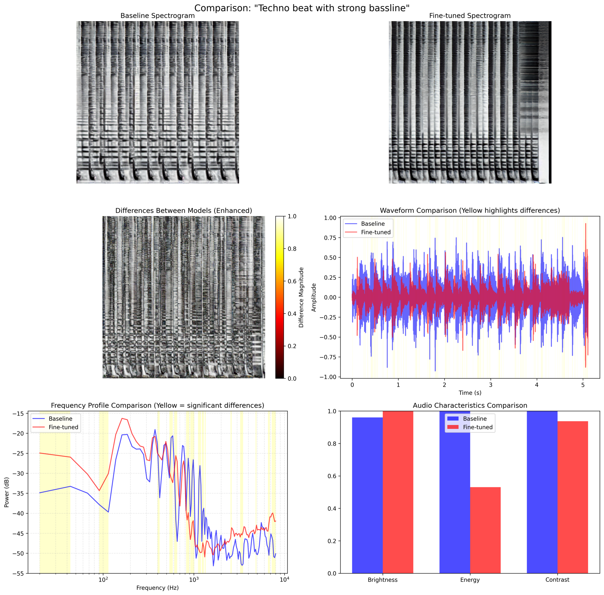
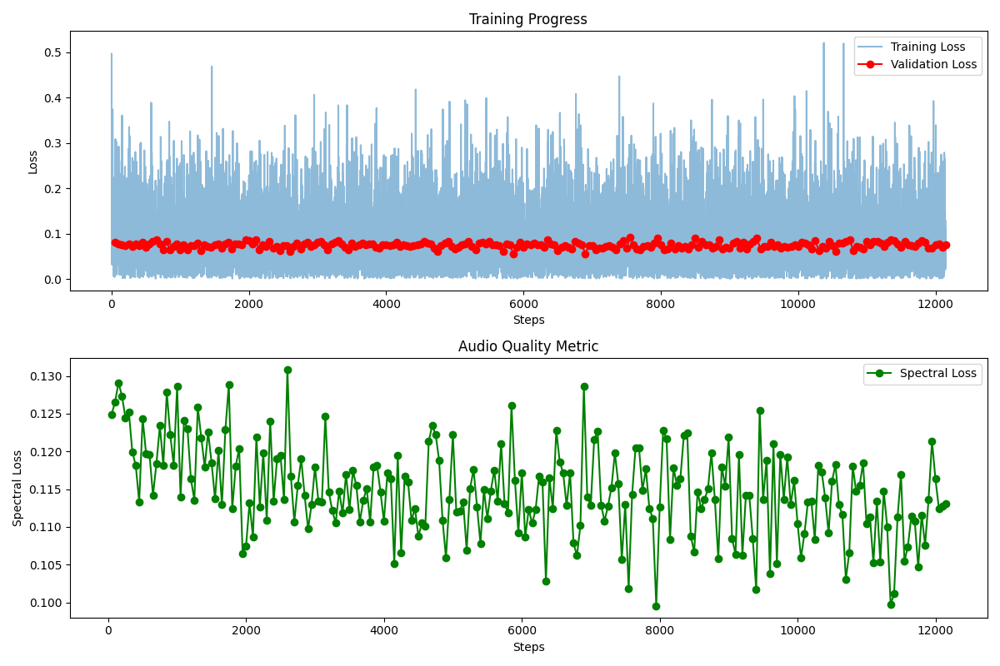
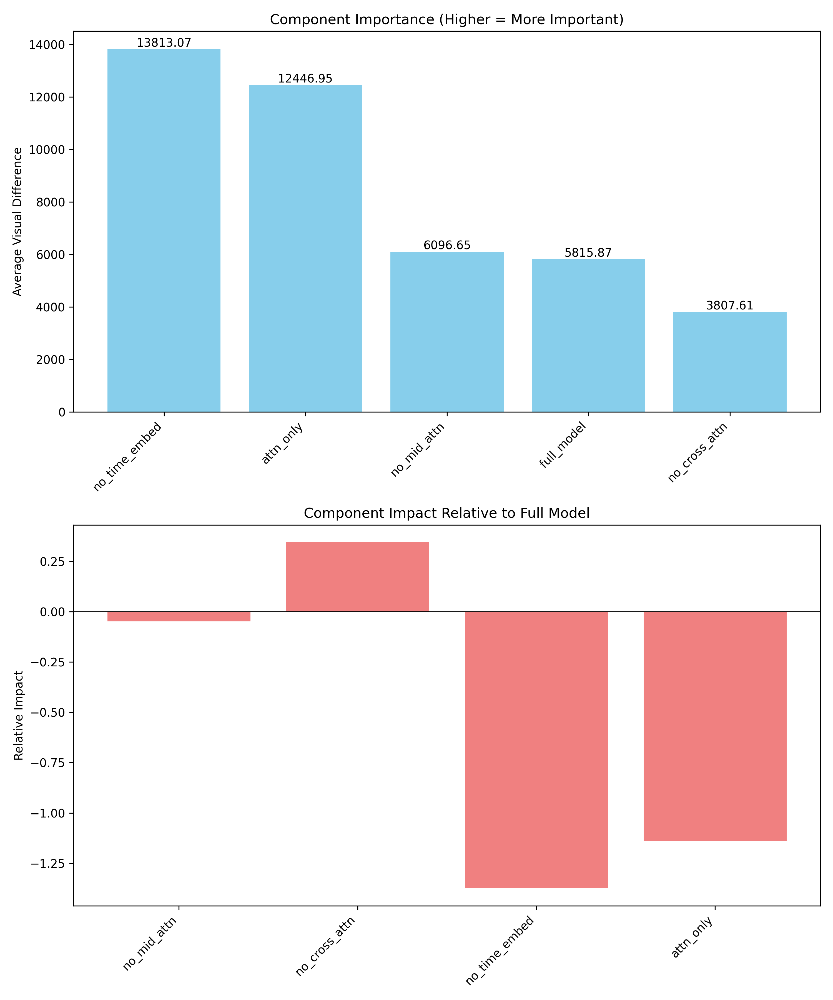

# riffusion-lora

Fine-tuning [Riffusion](https://github.com/riffusion/riffusion-hobby) (Stable Diffusion over mel-spectrograms) with LoRA on a professional EDM sample pack, so short text prompts produce genre-accurate drum loops, basslines, melodies, and one-shots. Includes a component-level ablation study of the UNet, latent-space blending between base and fine-tuned weights, and a Gradio GUI with prompt enhancement and outpainting. Built for the Computational Creativity module of my MSc at Queen Mary University of London.

**🔊 [Listen to the outputs](https://adinsegall.github.io/riffusion-lora/)** — 20 prompts, each rendered by the baseline model, a 50% latent blend, and the fine-tuned model, straight out of the ablation runs.

## Training setup

- **Base:** Riffusion v1 checkpoint, via the MIT-licensed `riffusion-hobby` fork
- **LoRA:** rank 64, alpha 128, lr 5e-5, batch size 4, 30 epochs
- **Data:** 1,742 labeled samples across 16 genres (60–170 BPM, 37 keys) from a commercial EDM sample pack. The pack is **not redistributed** here — to retrain, point the notebook at your own labeled sample folder. Dataset stats and visualizations are in `figures/dataset_overview.png` and `summary_stats.csv`.

## Ablation study

The study freezes different UNet component groups during fine-tuning and scores the outputs, then sweeps blend ratios between base and fine-tuned weights in latent space. Cross-attention layers carry most of the adaptation; the best-scoring configuration touches only ~8% of UNet parameters. Full numbers in [`ablation_study_report.md`](ablation_study_report.md).

## What's in the repo

- `Riffusion_Fine_Tuning_For_Music_Sample_Generation.ipynb` — the full Colab pipeline: dataset prep, LoRA training, inference + outpainting, model blending, ablation, gallery export
- `ablation_study_report.md`, `summary_stats.csv` — generated study outputs
- `figures/` — training curves, dataset stats, spectrogram comparisons, the Gradio GUI
- `docs/` — the hosted audio gallery (60 mp3 clips)
- `report.pdf` — final write-up

LoRA weights aren't hosted here — get in touch if you want them.

## Credits

Riffusion is by Seth Forsgren and Hayk Martiros; this project fine-tunes the community-maintained [riffusion-hobby](https://github.com/riffusion/riffusion-hobby) fork (MIT).
